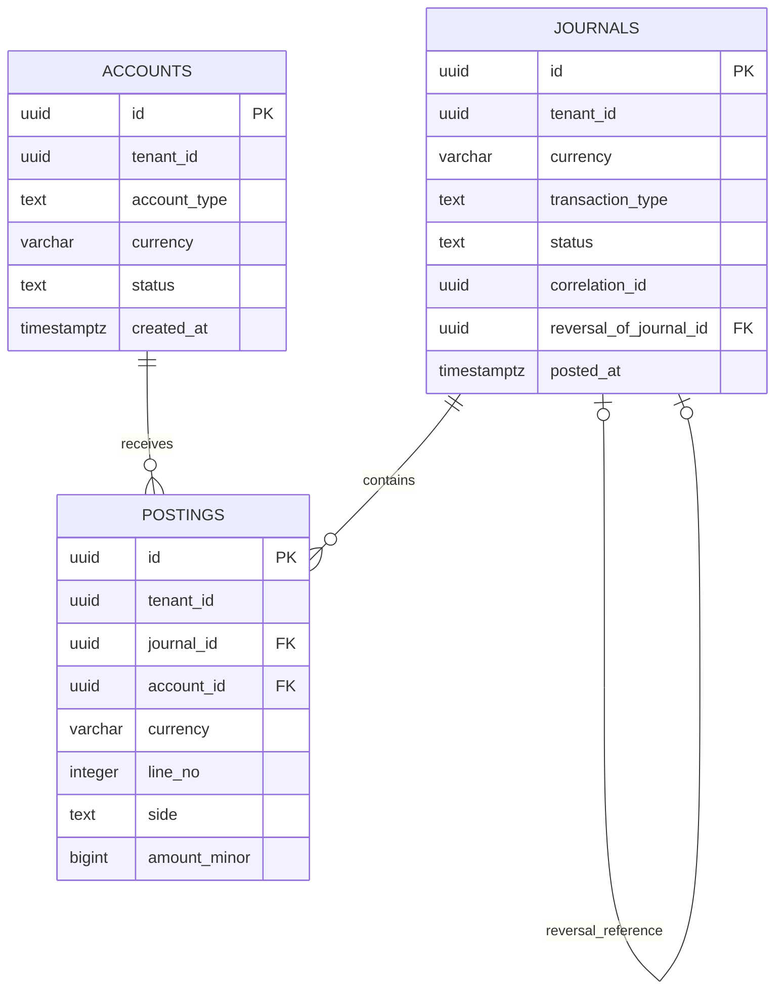
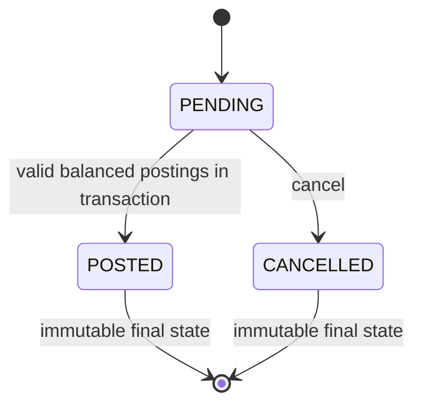
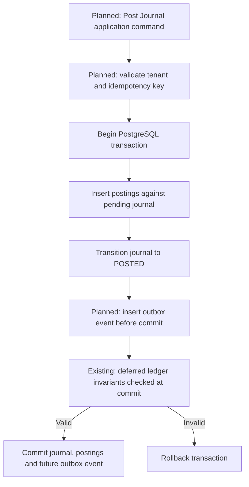

# Fintech Money Movement Platform

A ledger-first fintech infrastructure platform built with TypeScript,
Node.js, Express.js, PostgreSQL and Kysely.

The project focuses on financial correctness, transaction integrity,
auditability, concurrency safety and resilient money-movement
infrastructure.

> **Development status:** Financial primitives and the PostgreSQL
> ledger persistence foundation are implemented. The application-level
> ledger engine, wallets, payments and settlement workflows remain
> under development. The platform currently uses simulated funds.

## Architecture approach

- Modular monolith with explicit domain boundaries.
- PostgreSQL as the authoritative financial data store.
- Exact monetary representation using `bigint` minor units.
- Versioned Kysely migrations with database-enforced financial invariants.
- Transactional outbox and asynchronous workers planned for later milestones.
- Strong unit, property, integration and concurrency testing.

## Technology stack

| Area                     | Technology           |
| ------------------------ | -------------------- |
| Language                 | TypeScript / Node.js |
| HTTP framework           | Express.js           |
| Database                 | PostgreSQL 17        |
| Query builder            | Kysely               |
| Validation               | Zod                  |
| Financial representation | BigInt minor units   |
| Testing                  | Vitest, fast-check   |
| Infrastructure           | Docker Compose       |
| CI/CD                    | GitHub Actions       |

## Repository structure

```text
apps/
  api/             Express API foundation
  worker/          Background worker foundation

modules/
  ledger/          Ledger domain/application module

packages/
  money/           Exact money representation and arithmetic
  database/        PostgreSQL, Kysely, migrations and ledger schema

infrastructure/
  docker/          Local database infrastructure

docs/
  adr/             Architecture Decision Records
  architecture/    Technical designs and diagrams
  runbooks/        Operational procedures
```

## Local development

Requirements: Node.js 24, pnpm and Docker.

From the repository root:

```powershell
pnpm install --frozen-lockfile
Copy-Item .env.example .env
```

Set a local development password in `.env`, then start PostgreSQL:

```powershell
docker compose --env-file .env -f infrastructure/docker/compose.yaml up -d postgres
pnpm --filter @fintech/database migrate:up
```

Run quality checks:

```powershell
pnpm check
pnpm build
pnpm --filter @fintech/database test:integration
```

Integration tests require a running PostgreSQL instance.

---

## Ledger persistence — implemented foundation

> **Status:** PostgreSQL ledger schema, constraints, triggers, and migration-based integration tests are implemented and verified locally. The ledger posting application service, externally callable APIs, idempotency service, complete reversal processing, balance queries, and transactional outbox are **not yet implemented**. This project currently operates with development/simulated financial data, not real customer funds.

### Implemented capabilities

| Area                                | Current implementation                                                                                                                                    |
| ----------------------------------- | --------------------------------------------------------------------------------------------------------------------------------------------------------- |
| Exact monetary representation       | TypeScript `bigint` minor units; canonical string serialization; validated PostgreSQL signed `BIGINT` mapping                                             |
| Database layer                      | PostgreSQL 17, Kysely connection factory, validated environment configuration with Zod                                                                    |
| Migration lifecycle                 | Versioned migrations, migration history/locking, forward-only CLI (`migrate:status`, `migrate:up`)                                                        |
| Ledger persistence                  | `ledger.accounts`, `ledger.journals`, and `ledger.postings` created by migration `20261021_000002_create_ledger_tables`                                   |
| Journal lifecycle at database level | `PENDING` → `POSTED` or `CANCELLED`; finalized journals cannot be edited or deleted                                                                       |
| Journal financial integrity         | Deferred, commit-time checks: posted journals require at least two postings and equal total debits/credits                                                |
| Account and posting guards          | Positive posting amounts, immutable postings, protected account identity, active-account checks                                                           |
| Tenant/currency isolation           | Composite foreign keys enforce compatible tenant/currency across journal, account, and posting                                                            |
| Reversal references                 | References must identify a posted journal in the same tenant/currency; one reversal reference per original journal                                        |
| Ledger domain validation            | Pure `prepareBalancedJournal()` service with exact `bigint` debit/credit balancing, typed errors, immutable output and deterministic posting line numbers |

### Ledger database architecture



> Diagram is a conceptual summary. The actual migration includes composite tenant/currency foreign keys, unique keys, check constraints, indexes, and PostgreSQL triggers. [Detailed ledger persistence design](docs/architecture/ledger-persistence.md).

### Ledger domain validation — implemented

The Ledger module exposes `prepareBalancedJournal()`, a pure
TypeScript domain operation that prepares balanced double-entry
journal drafts without database or network access.

Implemented protections:

- At least two journal postings.
- At least one `DEBIT` and one `CREDIT`.
- Positive `bigint` amounts within the supported PostgreSQL
  signed `BIGINT` range, validated through `@fintech/money`.
- Exact debit/credit equality without floating-point arithmetic.
- Arbitrarily large `bigint` aggregate totals.
- Runtime checks for invalid posting values.
- Deterministic, sequential posting line numbers.
- Immutable prepared journal results.
- Typed `InvalidJournalDraftError` failure codes.

The prepared journal is not a database-persisted transaction.
Account ownership, account status, transaction atomicity,
idempotency and outbox persistence are enforced or implemented
at other layers and milestones.

**Test coverage:** 27 unit tests and 7 property-based tests,
including 2,100 generated property-test cases.

See [ADR-014: Journal domain validation](docs/adr/ADR-014-journal-domain-validation.md).

### Financial invariants verified against PostgreSQL

| Invariant                                                                   | Enforcement                               | Local verification |
| --------------------------------------------------------------------------- | ----------------------------------------- | ------------------ |
| Minimum two postings in a posted journal                                    | Deferred constraint trigger               | Verified           |
| Debit total = credit total for each posted journal                          | Deferred trigger; exact SQL aggregation   | Verified           |
| Non-posted journals cannot commit postings                                  | Deferred trigger                          | Verified           |
| Posting amount must be positive                                             | `CHECK (amount_minor > 0)`                | Verified           |
| Journal/account tenant and currency must match posting                      | Composite foreign keys and guarded writes | Verified           |
| Only active accounts accept postings                                        | PostgreSQL posting trigger                | Verified           |
| Posting rows cannot be updated or deleted                                   | PostgreSQL trigger                        | Verified           |
| Finalized journals cannot be updated or deleted                             | PostgreSQL trigger                        | Verified           |
| Account identity and currency cannot change                                 | PostgreSQL trigger                        | Verified           |
| Closed accounts cannot reopen                                               | PostgreSQL trigger                        | Verified           |
| Reversal reference must point to posted journal in matching tenant/currency | PostgreSQL trigger and foreign key        | Verified           |
| Duplicate reversal references blocked                                       | Unique constraint                         | Verified           |

**Important scope distinction:** These are **database-level** guarantees tested using direct SQL. They do not yet imply that an application-level ledger posting API, reversal service, or outbox is shipped. A full reversal's inverse amounts, idempotent command replay, and available-balance/overspending enforcement remain future milestones.

### Journal lifecycle (database-enforced)



### Journal posting workflow (implementation roadmap)

The **database checks and constraints** shown below already exist. The end-to-end **application command, idempotency record, and outbox event** portions are planned, not yet shipped.



The outbox step is **future scope**; when implemented it must execute before commit, in the same transaction. The full target workflow is documented in [ledger persistence architecture](docs/architecture/ledger-persistence.md).

### Engineering decisions

- [ADR-012: PostgreSQL ledger persistence and financial invariants](docs/adr/ADR-012-ledger-persistence-and-invariants.md)
- [ADR-013: UUIDv7 identifier policy](docs/adr/ADR-013-uuidv7-identifier-strategy.md)
- [ADR-014: Pure journal domain validation](docs/adr/ADR-014-journal-domain-validation.md)

### Testing and reproducibility

Commands run from repository root (PostgreSQL must be running for integration tests):

```powershell
pnpm check
pnpm build
pnpm --filter @fintech/database test:integration
pnpm --filter @fintech/database migrate:status
pnpm --filter @fintech/ledger test
```

Latest **locally reported** results after the ledger migration:

| Verification                               | Result                                         |
| ------------------------------------------ | ---------------------------------------------- |
| Money unit/property tests                  | 97 passed                                      |
| Database unit tests                        | 100 passed                                     |
| Ledger domain unit tests                   | 27 passed                                      |
| Ledger domain property tests               | 7 passed                                       |
| PostgreSQL integration tests               | 32 passed in previous database integration run |
| Unit/property tests total                  | **231 passed**                                 |
| Combined previously verified test coverage | **263 tests**                                  |
| TypeScript, ESLint, Prettier, build        | Passed locally                                 |

CI workflows: the existing Validate-and-Build workflow under `.github/workflows/` and `.github/workflows/database-integration.yml`. A previous commit passed both workflows; **the 23 new ledger invariant tests must be verified in CI after this change is pushed** before claiming updated CI coverage.

### Known limitations / next milestones

1. No application-level ledger account creation or atomic journal posting service yet.
2. No HTTP ledger endpoints, tenant authentication/authorization, or validated API contracts yet.
3. Reversal **references** are constrained, but exact inverse financial postings and reversal service are not implemented.
4. Idempotency records, request-hash conflict detection, transactional outbox, and async event delivery are not implemented.
5. Account balances, holds, availability and concurrent overspend protection are not implemented.
6. Database runtime least-privilege role and deployment/operational hardening are pending; local development credentials have elevated privileges.
7. `UUID` columns accept compatible UUID values generally; UUIDv7 is the chosen policy for new platform-generated IDs, not yet a universal database-enforced rule.
8. No live-money, licensed custody, or regulated processing claims are made.
