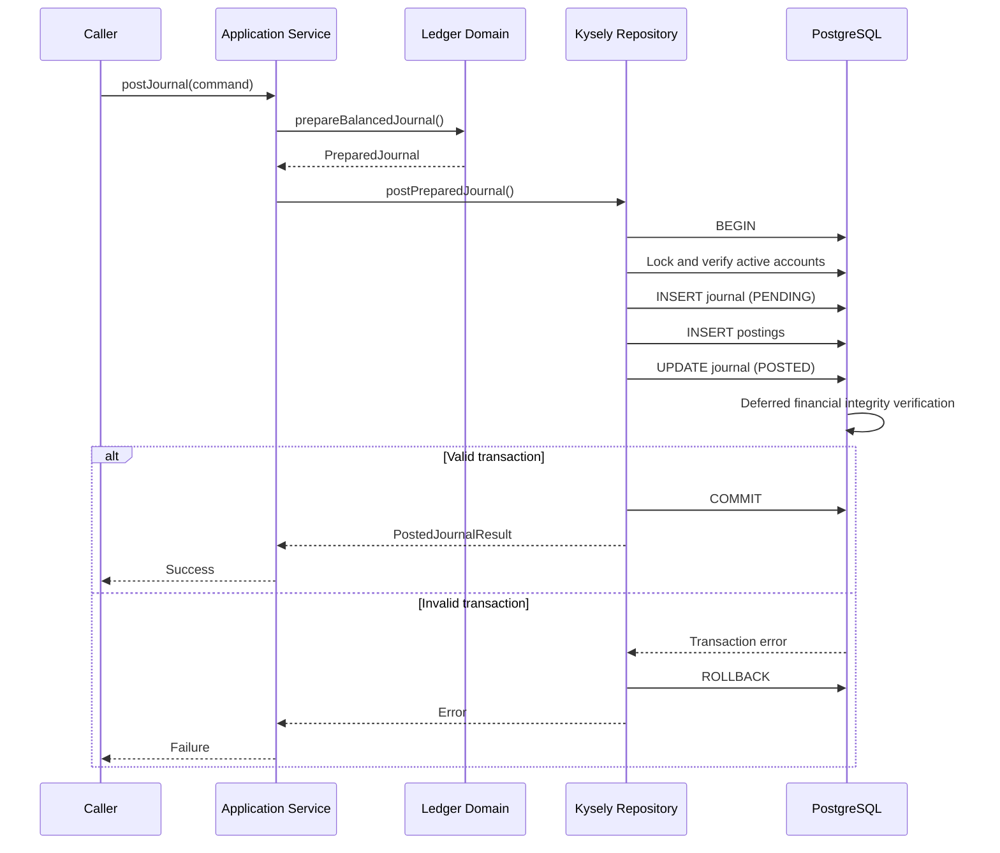

# ADR-015: Atomic Ledger Posting with PostgreSQL Transactions

- **Status:** Accepted
- **Date:** 2026-10-23
- **Scope:** Ledger application and infrastructure layers

## Context

The platform already provides a pure journal validation domain
operation and PostgreSQL-enforced double-entry integrity constraints.

The next requirement is to connect these components through an
application-level posting operation that persists a complete
financial journal atomically.

An incomplete or partially committed journal is unacceptable.

## Decision

Implement a `createPostJournalService()` application service
and a `LedgerPostingRepository` persistence port.

The application service handles:

- Domain journal preparation and balancing.
- Identifier syntax validation.
- Transaction type validation.
- Delegation to the repository.
- Propagation of persistence failures.

The repository adapter uses Kysely and PostgreSQL.

It owns the database transaction boundary and performs all
related journal/posting writes within the same transaction.

## Transaction workflow

The repository transaction promise resolves only after
PostgreSQL successfully commits.

## Financial integrity

The domain verifies the submitted journal before persistence.

PostgreSQL independently enforces:

- Tenant and currency containment through composite foreign keys.
- Positive posting amounts.
- Posting insert restrictions.
- Journal lifecycle transitions.
- Immutable posted records.
- Minimum posting count and debit/credit equality at commit.

Domain validation does not replace database enforcement.

A balanced journal does not necessarily imply sufficient
available funds. Balance availability, holds and overspending
prevention remain outside the scope of this milestone.

## Concurrency and locking

The repository collects distinct posting account IDs and
acquires account row locks in deterministic order.

It verifies that accounts are active in the requested tenant
and currency.

This reduces deadlock risk and prevents conflicting account
status updates from silently invalidating the posting operation.

PostgreSQL triggers independently guard the same account state.

Lock ordering reduces deadlock risk but does not eliminate every
possible deadlock involving other database operations.

## Identifier strategy

The implementation generates new journal and posting IDs
using UUIDv7.

This follows the platform's adopted identifier strategy.

UUIDv7 provides time-oriented index locality benefits but
does not guarantee globally sequential identifiers.

## Error behavior

Expected account unavailability uses
`LedgerAccountUnavailableError`.

The error deliberately avoids revealing whether an account
belongs to another tenant.

Database constraint failures propagate as transaction failures.
They must not be treated as successful posted transactions.

Public HTTP error mapping remains a separate concern.

## Idempotency limitations

The initial posting service is intentionally not idempotent.

Two identical successful commands may create different journals.

A correlation ID provides traceability; it is not an
idempotency key and currently has no uniqueness guarantee
for financial commands.

Idempotency and request-hash conflict protection must be
introduced before exposing externally retriable money-movement
operations.

The posting service is currently internal-only. It validates
tenant identifier syntax but does not authenticate or authorize
tenant identity. Authorization must be established by a trusted
caller before financial posting is permitted.

## Event delivery limitations

The service does not yet persist transactional outbox events.

Reliable asynchronous event delivery will require an outbox
record inserted inside the same financial transaction.

A successful journal commit does not currently imply
an event has been published.

## Alternatives considered

### Independent database operations

Rejected because journal and posting writes could be
partially persisted.

### Database interaction inside the domain service

Rejected to preserve domain purity and testability.

### Return success before COMMIT

Rejected because commit-time deferred constraints may fail.

### Rely only on application validation

Rejected because database writes need independent integrity
protection.

## Verification evidence

The PostgreSQL integration suite passed 10 tests covering:

- Atomic two-posting journal persistence.
- Balanced three-posting journals.
- Missing accounts.
- Suspended accounts.
- Cross-tenant account containment.
- Currency incompatibility.
- Commit-time integrity failure and rollback.
- Concurrent account suspension.
- Concurrent independent journal posting.
- Repeated commands without idempotency.

The suite was verified locally against a disposable PostgreSQL
test database.

Unit/property test and build verification is tracked
separately through the repository quality gate.

## Consequences

### Benefits

- Atomic financial persistence.
- Separation of application and infrastructure concerns.
- Independent PostgreSQL enforcement.
- Improved concurrency handling.
- Testable application orchestration.
- Deterministic account locking.
- Explicit error contracts.

### Trade-offs

- Requires PostgreSQL availability.
- Account locks may increase contention.
- Deadlock retries are not yet part of the service contract.
- Repeated commands can generate duplicate financial effects.
- Authorization, idempotency, reversals and outbox delivery
  remain separate milestones.

## Follow-up work

1. Introduce durable idempotency keys and payload fingerprints.
2. Implement replay handling and conflicting-command rejection.
3. Add transactional outbox persistence.
4. Implement reversal posting and reversal integrity.
5. Add authorized API integration and observability.
6. Introduce balance and concurrency-specific financial guards.

## Related decisions

- [ADR-012: Ledger persistence](ADR-012-ledger-persistence-and-invariants.md)
- [ADR-013: UUIDv7 identifiers](ADR-013-uuidv7-identifier-strategy.md)
- [ADR-014: Domain journal validation](ADR-014-journal-domain-validation.md)

## Subsequent evolution

On 2026-10-26, ADR-016 introduced durable command idempotency
and replaced the initial non-idempotent retry behavior.

The atomic journal posting and database transaction decisions
of this ADR remain in effect.

See [ADR-016: Financial Command Idempotency](ADR-016-financial-command-idempotency.md).
