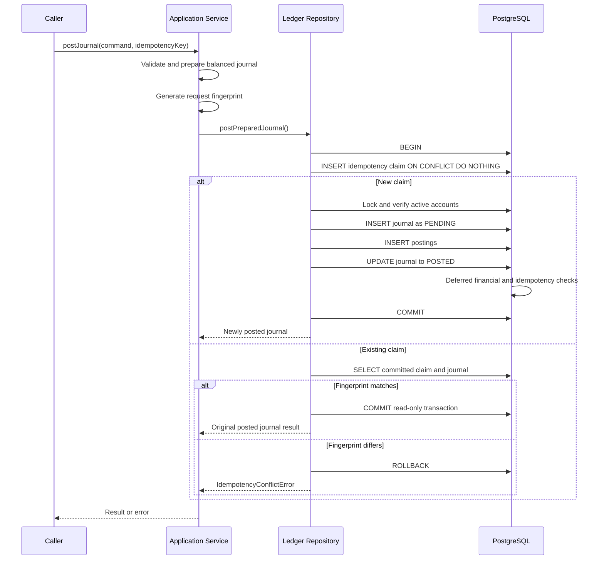

# ADR-016: Durable Financial Command Idempotency

- **Status:** Accepted
- **Date:** 2026-10-26
- **Scope:** Ledger application, persistence and financial command processing
- **Related milestone:** Task 13E

## Context

The platform implements atomic double-entry journal posting through
a Ledger application service and PostgreSQL transaction.

Atomic persistence prevents partially committed journals, but it
does not prevent duplicate financial effects when a caller retries
an already committed command.

For example:

1. A client submits a financial posting command.
2. PostgreSQL commits the journal and postings.
3. The response is lost before reaching the client.
4. The client retries the same command.
5. Without idempotency, another journal may be committed.

The platform requires durable, transactionally enforced command
identity to prevent duplicate journal creation for the same
financial operation.

## Decision

Implement durable financial command idempotency using PostgreSQL.

Each posting command must supply an idempotency key. The application
service creates a deterministic SHA-256 fingerprint of the financial
intent and passes both values to the repository.

The repository claims the command identity and persists the journal
inside one PostgreSQL transaction.

The idempotency key is scoped by:

- Tenant ID
- Operation type
- Idempotency key

The database enforces uniqueness across these three fields.

### Required behavior

| Scenario                                  | Behavior                                                      |
| ----------------------------------------- | ------------------------------------------------------------- |
| New key                                   | Create and commit one journal                                 |
| Existing key, identical financial payload | Replay original committed journal result                      |
| Existing key, different financial payload | Reject with `IdempotencyConflictError`                        |
| Concurrent identical requests             | Coordinate through PostgreSQL uniqueness; one journal commits |
| Financial transaction fails               | Roll back journal, postings and idempotency claim             |
| Different keys                            | Permit independent operations                                 |
| Same key in different tenants             | Treat as independent command identities                       |

These guarantees apply to this PostgreSQL-backed posting operation,
not to all external payment systems or downstream side effects.

## Database persistence model

Migration:

`20261025_000003_create_ledger_idempotency_records.ts`

Table:

`ledger.idempotency_records`

### Schema contract

| Column            | Purpose                                 |
| ----------------- | --------------------------------------- |
| `tenant_id`       | Tenant scope                            |
| `operation_type`  | Financial operation identity            |
| `idempotency_key` | Caller-supplied retry identity          |
| `request_hash`    | SHA-256 financial command fingerprint   |
| `journal_id`      | Referenced committed journal            |
| `created_at`      | Database-generated record creation time |

Primary key:

`(tenant_id, operation_type, idempotency_key)`

Additional constraints:

- Unique `(tenant_id, journal_id)`.
- Composite foreign key to `ledger.journals`.
- Deferred foreign-key checking.
- Deferred trigger verifying the referenced journal is `POSTED`.
- Database trigger preventing updates or deletes of committed
  idempotency records.
- Validation constraints for key and fingerprint format.

The idempotency record contains no mutable processing-status column.

An uncommitted claim is managed by the surrounding PostgreSQL
transaction. A failure rolls back the claim and associated financial
writes together.

## Canonical request fingerprint

The application calculates a SHA-256 fingerprint using a versioned,
deterministic JSON representation.

The current `POST_JOURNAL_V1` fingerprint includes:

- Tenant identifier, normalized to lowercase.
- Currency.
- Transaction type.
- Ordered postings.
- Posting line numbers.
- Account identifiers, normalized to lowercase.
- Debit/credit sides.
- Exact `bigint` monetary values serialized as decimal strings.

The fingerprint deliberately excludes the correlation ID.

A correlation ID represents traceability metadata. A retry may use
a different correlation ID while representing the same financial
operation.

Posting order is included in the fingerprint. Changing line order
therefore changes the current command identity, even when the
financial totals remain equal.

The fingerprint is used for equality comparison; it is not an
authentication token, authorization mechanism or digital signature.

## Transaction and concurrency protocol

The repository uses Kysely and PostgreSQL transactions.

The unique primary key provides concurrency coordination between
transactions attempting to claim the same command identity.

Under PostgreSQL `READ COMMITTED` isolation, a conflicting insert
may wait for the first transaction to commit or roll back.

After an `ON CONFLICT DO NOTHING` outcome, the repository performs
a separate SQL statement to read the committed original claim.

This separate read matters because it uses a fresh statement
snapshot under `READ COMMITTED`.

### Concurrent request guarantees

When two requests use the same tenant, operation and key:

- Both cannot commit distinct idempotency records.
- The committed financial command can be replayed by the other.
- A different fingerprint produces a conflict rather than another
  journal.
- If the first transaction rolls back, a waiting request may
  acquire the claim and execute the command.

These behaviors are verified against PostgreSQL.

The design assumes PostgreSQL `READ COMMITTED` isolation. Other
isolation levels require additional testing and possibly retry
handling.

## Replay semantics

An identical retry returns the original persisted financial result.

The result contains:

- Original journal ID.
- Original tenant ID.
- Original correlation ID.
- Original currency and transaction type.
- Original posting count.
- Original posting timestamp.
- `POSTED` status.

The repository does not create another journal on replay.

The new request's correlation ID does not overwrite the original
journal's correlation ID.

## Financial integrity and atomicity

The following writes must share one transaction:

1. Idempotency claim.
2. Pending journal insertion.
3. Financial posting insertions.
4. Journal finalization.

PostgreSQL commit-time checks independently verify:

- Balanced debit and credit totals.
- Required posting count.
- Tenant and currency containment.
- Valid journal lifecycle.
- The idempotency claim references a posted journal.

A failed commit must leave neither a new committed financial
journal nor a committed idempotency claim.

Idempotency does not replace double-entry accounting invariants.

## Security and trust boundaries

Idempotency scope depends on the tenant identifier.

The current service validates tenant UUID syntax but does not
authenticate or authorize the tenant.

A trusted application boundary must establish tenant identity
before invoking the posting service.

Idempotency keys must not be treated as authorization credentials.

Raw financial payloads, idempotency keys and tenant identifiers
must not be exposed as high-cardinality Prometheus metric labels.

## Alternatives considered

### In-memory idempotency cache

Rejected because process restarts, multiple instances and cache
eviction cannot provide the required durable financial guarantee.

### Redis-only command locks

Rejected as the financial source of truth because lock ownership
and PostgreSQL journal commits would not share one atomic transaction.

Redis may later be used for auxiliary coordination, but not as the
authoritative idempotency record.

### Correlation ID as idempotency key

Rejected because tracing identity and financial command identity
have different semantics.

### Separate idempotency and journal transactions

Rejected because one transaction could commit while the other
fails, leaving inconsistent command state.

### Check for existing journal before inserting

Rejected because a read-before-write check alone does not safely
coordinate concurrent identical requests.

### Update the existing command result on retry

Rejected because committed financial command identity and
accounting history must remain stable.

## Verification evidence

The Ledger PostgreSQL integration suite passed 16 tests locally.

Idempotency-specific verification includes:

- Replay of the original journal for the same command.
- Conflict rejection for changed financial payload.
- Concurrent identical request coordination.
- Original correlation ID preservation.
- Independent journals for different keys.
- Idempotency claim rollback after failed financial commit.
- Rejection of committed idempotency-record mutation.

Additional unit tests verify deterministic request fingerprint
generation, excluded correlation metadata, changed financial
payloads and invalid idempotency keys.

At milestone closeout, the locally reported quality gates were:

| Verification             | Passed tests |
| ------------------------ | -----------: |
| Money unit/property      |           97 |
| Database unit            |          100 |
| Ledger unit/property     |           51 |
| Database integration     |           32 |
| Ledger integration       |           16 |
| **Combined local total** |      **296** |

These are combined results from the relevant suites; they are
not one single test-run count.

TypeScript, ESLint, formatting and build checks passed locally.
Updated GitHub Actions verification is recorded separately.

## Consequences

### Benefits

- Durable retry identity.
- Single-journal behavior for same-key retries.
- Deterministic conflict detection.
- Concurrency coordination through PostgreSQL.
- Atomic rollback of financial records and command claims.
- Immutable committed idempotency history.
- Replay of the original committed financial result.

### Trade-offs

- Additional database writes and uniqueness contention.
- Same-key concurrent requests may block while the first
  transaction finishes.
- Long-running financial transactions can increase wait times.
- Committed records have no automatic TTL or cleanup policy.
- Idempotency keys must be managed correctly by callers.
- The fingerprint format requires explicit version management
  when financial command semantics change.

## Limitations

This decision does not provide:

- End-to-end exactly-once external payment processing.
- Authentication or tenant authorization.
- Available-balance or overspending protection.
- Reversal processing.
- Transactional outbox or reliable event publication.
- Automatic handling of every SQL deadlock or serialization failure.
- A retention, partitioning or archival strategy.
- Idempotency across different keys representing the same
  real-world business action.

The operation remains internal-only until its external API,
authorization and operational contracts are implemented.

## Observability requirements

A future observability milestone must instrument:

- New command posting duration and outcome.
- Successful idempotency replay.
- Idempotency conflicts.
- PostgreSQL transaction failure and rollback.
- Concurrent claim contention and relevant latency.
- Distributed trace propagation into the database operation.

Prometheus metrics must use bounded-cardinality labels.

OpenTelemetry tracing must avoid recording raw sensitive
financial payloads or full idempotency keys.

Telemetry export failures must not influence whether a
financial transaction commits.

## Follow-up work

1. Implement OpenTelemetry traces, Prometheus metrics and
   Grafana/Tempo visualization for Ledger operations.
2. Implement the transactional outbox within the financial
   transaction boundary.
3. Implement journal reversal handling and financial audit flows.
4. Implement authenticated, tenant-authorized API contracts.
5. Introduce account balance and overspending safeguards.
6. Define idempotency retention and operational recovery policies.

## Related decisions

- [ADR-012: Ledger persistence](ADR-012-ledger-persistence-and-invariants.md)
- [ADR-013: UUIDv7 identifier strategy](ADR-013-uuidv7-identifier-strategy.md)
- [ADR-014: Journal domain validation](ADR-014-journal-domain-validation.md)
- [ADR-015: Atomic ledger posting](ADR-015-atomic-ledger-posting.md)
