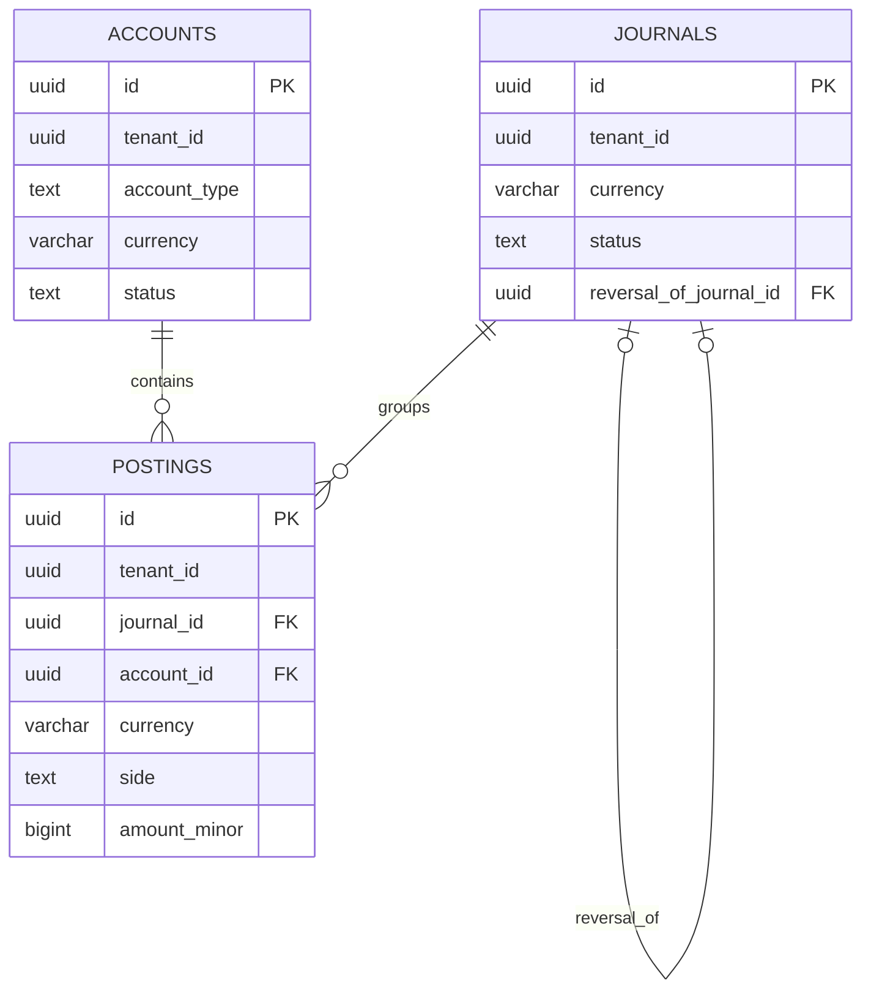
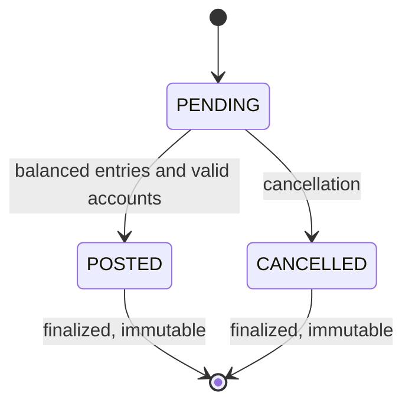
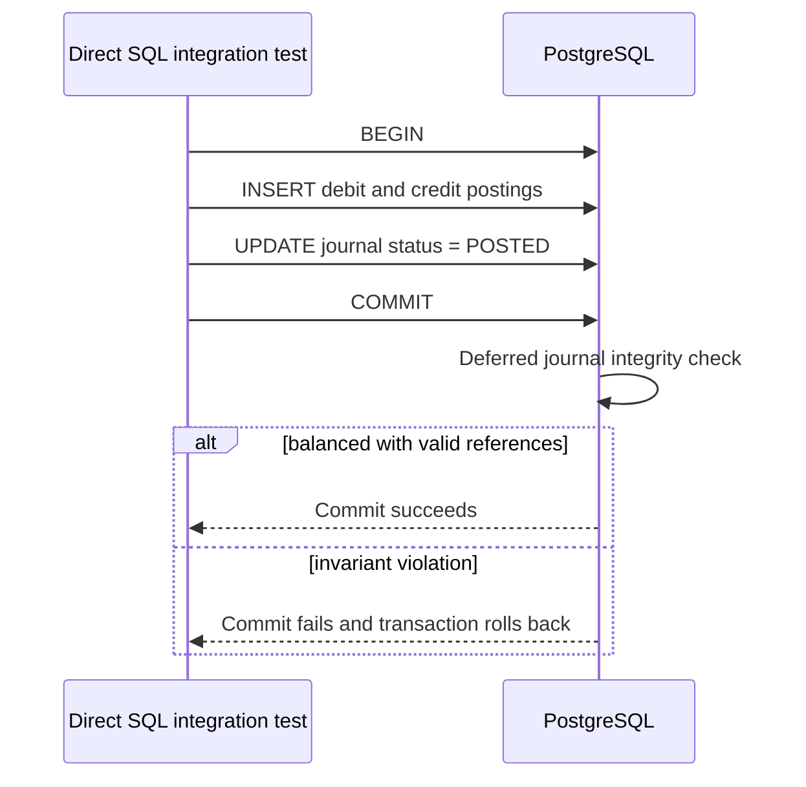
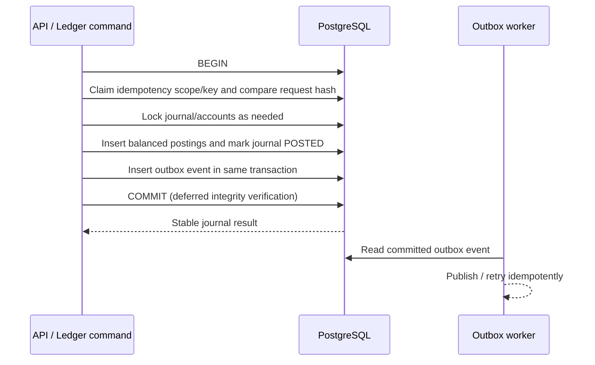

# Ledger persistence architecture — Task 13B

**Scope:** PostgreSQL schema and database-enforced financial integrity. Not an implemented API or complete ledger engine.

## System boundaries

- `packages/database`: Kysely connections, migrations, PostgreSQL drivers, and exact `BIGINT` mapping.
- `modules/ledger`: future domain/application contracts, posting commands, persistence adapters; currently not the implemented posting engine.
- PostgreSQL: financial system of record. Redis and future event systems are not accounting truth.
- Tenant IDs are stored in ledger tables; an organization master-table relationship and tenant-aware authorization will be added with the identity/business modules.

## Database objects

Migration `20261021_000001_create_ledger_schema` creates namespace `ledger`. Migration `20261021_000002_create_ledger_tables` defines three tables:

- `ledger.accounts`: `id`, `tenant_id`, `account_type` (`ASSET`, `LIABILITY`, `EQUITY`, `REVENUE`, `EXPENSE`), `currency`, `status` (`ACTIVE`, `SUSPENDED`, `CLOSED`), `created_at`.
- `ledger.journals`: tenant/currency, transaction type, lifecycle status (`PENDING`, `POSTED`, `CANCELLED`), correlation/reversal references, effective/posted/cancelled timestamps.
- `ledger.postings`: tenant, journal, account, line number, debit/credit side, positive signed-64-bit minor-unit amount, currency and creation timestamp.

Postings have FKs to journal and account using **tenant and currency** together. Posting `amount_minor` is strictly positive and fits PostgreSQL `BIGINT`. Totals use exact PostgreSQL numeric aggregation, not JavaScript floating point.

## Financial invariants and enforcement

| Condition                                           | Mechanism                                                  |
| --------------------------------------------------- | ---------------------------------------------------------- |
| Posted journal has >= 2 postings                    | Deferred constraint triggers, validated at commit          |
| Sum of debit amounts equals sum of credit amounts   | Deferred trigger; aggregation on `NUMERIC`                 |
| No committed postings for pending/cancelled journal | Deferred trigger                                           |
| No zero/negative posting amounts                    | `CHECK (amount_minor > 0)`                                 |
| Account/journal tenant and currency match posting   | Composite FKs plus write guards                            |
| No posting to suspended/closed account              | Trigger checks account under `FOR SHARE` lock              |
| No posting after journal finalization               | Trigger locks parent journal `FOR UPDATE`                  |
| Account identity immutable / closed not reopened    | Account write trigger                                      |
| Finalized journal and any posting immutable         | Journal/posting write triggers                             |
| No duplicate reversal link for original journal     | Unique constraint on `(tenant_id, reversal_of_journal_id)` |

These database guards protect ordinary SQL DML under appropriate permissions. Superusers/table owners can change or disable schema enforcement: a separate least-privilege runtime role is still a required hardening milestone.

## Journal lifecycle

Pending journals may be inserted without postings. The initial schema requires a posting transaction to insert all lines and finalize the journal in **one transaction**; a commit with lines still pending is rejected. Posted journal balances cannot be edited: business corrections will create linked reversal journals in a later milestone.

## Transaction paths

### Verified database-only path

### Planned application workflow (not implemented yet)

This planned sequence requires application services, idempotency and outbox migrations, and tests before it may be claimed implemented.

## Verification and known gaps

`packages/database/tests/integration/ledger-schema.integration.test.ts` runs against a disposable PostgreSQL database and validates 23 ledger schema cases, including successful posting, unbalanced rollback, tenant/currency mismatch, account status restrictions, immutability and reversal reference uniqueness. Existing connectivity and migration suites add 9 integration tests.

- Only database-level financial integrity is verified; no API posting service yet.
- Exact inverse reversal amounts are not yet enforced by a reversal service.
- Balance projection and overspending controls are not implemented.
- Foreign-key tenant scope protects references but does not replace authorization.
- PostgreSQL runtime/migration role separation and schema hardening are not yet complete.
- New primary IDs use the UUIDv7 **design policy**; tests use UUIDv7 fixtures, while application-level ID generation is future implementation.

## Related decisions

- [ADR-012: Ledger persistence and invariants](../adr/ADR-012-ledger-persistence-and-invariants.md)
- [ADR-013: UUIDv7 identifiers](../adr/ADR-013-uuidv7-identifier-strategy.md)
